# GoDW · 通用数据仓库系统（Go）

> 元数据驱动、引擎无关、单二进制可跑的数据仓库平台，覆盖 `数据接入 → ODS → DWD → DWS → ADS → 看板` 全链路。建模、管道、质量、调度、血缘、界面都可配置、可版本化、可回滚。

**当前状态：可运行。** 不是设计稿——本文档描述的能力已经在仓库里实现并通过端到端验证（10 万行样例数据跑通四层链路，节点级结果、质量门禁、血缘、审计均可查）。

---

## 0. 五分钟跑起来

```bash
# 1) 起依赖（postgres/redis/mysql/clickhouse/minio）
make up

# 2) 建表
export GODW_DB_PASSWORD=godw
export GODW_AUTH_JWT_SECRET=$(openssl rand -hex 16)
make migrate

# 3) 一键演示：灌数 → 建模型 → 发布管道 → 回填 7 天 → 校验门禁
make demo

# 4) 启动控制面（内嵌调度与执行器）
make run
# 浏览器打开 http://localhost:8080，账号 admin@godw.local / admin12345
```

`make demo` 是幂等的：重跑会重建演示数据，结果与上次一致。它同时是一条端到端自检——
跑不通就说明依赖或迁移有问题，先解决再往下走。演示包含 4 张源表（订单 10 万、商品 1 万、
店铺 1000、退款 2 万）、3 条管道（订单链路、退款链路、故意失败的质量门禁）和 3 张看板。

没有 Docker 也可以：本机装好 PostgreSQL，改 `config.dev.yaml` 的 `db.host/user/database`，同样三行命令跑起来。

不想装 Go 环境：`bash scripts/release.sh` 在 `dist/` 下打出三个平台的压缩包（macOS Intel / Apple Silicon / Linux），
拿包的人按 [docs/12-离线包使用说明.md](docs/12-离线包使用说明.md) 三条命令即可运行，无需编译。

DuckDB 是嵌入式引擎，驱动需要 CGO，默认不编进二进制。要用它请单独构建：

```bash
go build -tags duckdb -o bin/godw-server ./cmd/godw-server
```

默认二进制遇到 `type: duckdb` 会明确提示需要 `-tags duckdb`，而不是给一句「不支持的数据源类型」。

四引擎集成测试（会起 PG/MySQL/ClickHouse，真的建表查数）：

```bash
make test-integration
```

冒烟脚本会真的跑一遍完整链路并校验每个节点：

```bash
bash scripts/smoke.sh
```

```
1/5 健康检查
2/5 触发管道 order_daily（业务日期 2026-11-09）
3/5 触发执行
5/5 校验产物
    src_order              success  rows=100000 21ms
    dwd_order              success  rows=100000 560ms
    q_dwd_order            success  rows=0 57ms
    dws_order_daily        success  rows=3 87ms
    ads_order_dashboard    success  rows=1 61ms
    全部节点成功
冒烟通过
```

## 0.1 已经实现的能力

| 层 | 能力 | 关键实现 |
|---|---|---|
| 接入 | PostgreSQL / MySQL / ClickHouse / DuckDB 连接器，能力矩阵 + 连接池复用；四种引擎均在真实实例上跑通建表/写入/质量/指标/采集（见 [验证记录](docs/11-引擎验证记录.md)） | `internal/connector`、`internal/dialect` |
| 元数据 | 结构采集（重试 + 变更比对）、环境绑定、PII 识别、全文+模糊搜索、标签 | `dataset`/`schema_change`/`tag`、`CollectWithDiff` |
| 建模 | YAML → 规范校验 → DDL 编译 → 版本化；分层前缀/必填列/反向依赖硬拦截 | `internal/modelc`、`model_version` 快照 |
| 类型 | 4 引擎 × 12 逻辑类型矩阵，有损映射必须显式 `allow_lossy` | `dialect/types_matrix.go` |
| 分区 | 跨引擎分区表达式翻译、TTL（30d/12m/3y）、分桶、Schema diff 与迁移 SQL | `modelc/partition.go`、`modelc/diff.go` |
| 管道 | YAML 编排 DAG → 成环/依赖/参数校验 → 分层并发执行 | `internal/pipeline/compile`、`node.Executor` |
| 写入 | 七种策略：append/overwrite/merge/scd2/full_refresh/delete_insert/overwrite_partition | `sqlx.PlanWrite` 按 `Capability` 选型 |
| 增量 | 分区优先 → 时间列 → 明确报错，不猜 | `compile.InferIncremental` |
| 试跑 | dry-run 只渲染不连库；sample-run 强制 LIMIT、绝不写表 | `service.DryRun/SampleRun` |
| 调度 | 5 段 cron、T-1 派发、幂等键、两段式队列、资源组配额、租约心跳、僵尸回收 | `internal/scheduler`、`instance` 状态机 |
| 运维 | 实例按管道/状态/日期筛选 + 服务端分页、批量重跑/取消、**节点级重跑**（重置该节点与下游）、失败行展开错误、实例抽屉（参数/耗时条/质量/实时日志）、**渲染 SQL 按版本快照还原并可对比上次**、**运行矩阵**（节点 × 最近 N 次运行，点格子进实例）、**按模型选择器触发**（先预览命中范围） | `ListInstancesPage`、`Service.RetryNode`、`Service.InstanceNodeSQL`、`Repo.InstanceMatrix` |
| 触发 | file/table/http 传感器 + 事件去重 | `node/sensor` |
| 观测 | 环形日志缓冲 + 批量落库 + 脱敏 + SSE 断点续传；6 类告警 + 去重 + 静默窗口 | `obs/logstore`、`obs/alert` |
| 质量 | 10 类规则 DSL（含 `freshness` 数据新鲜度）、按分区收窄作用域（freshness 除外）、error 阻断 / warn 记录、强制放行、隔离表 | `internal/quality` |
| 血缘 | SQL 解析（失败降级）、表级图、**列级下钻**（按表泳道 / 逐列聚焦 / 上下游切换）、Focus/Paths/DOT、LRU 缓存；图内**分层着色**（ODS/DWD/DWS/ADS）、搜索、双击聚焦 N 跳、导出 PNG | `internal/lineage`、`lineage_edge`、`lineage_column`、`assets/app.js` |
| 语义层 | 数据集（禁 ODS/禁无 on join）、全参数化查询构建、9 种图表编码校验 | `internal/semantic` |
| 图表 | 自研交互式折线（hover 多系列 tooltip、图例开关、刷选缩放）、看板全局时间/维度筛选、卡片全屏 | `assets/chart.js`、`RunCards` |
| 图表卡与看板编辑 | BI 图表可作看板卡片（折线/柱/堆叠/饼/环/指标卡/表格 7 种），与指标卡混排；看板编辑器为「卡片列表 + 高级 YAML」，类型/引用/宽度/排序行内可改 | `semantic.Card.chart`、`assets/app.js` |
| 自助查询 | 只读 SQL 控制台：SELECT/WITH 白名单、单语句、写关键字黑名单、15s 超时、行数上限、结果值归一化、列级脱敏按输出列名匹配；审计存指纹 | `internal/sqlx/guard.go`、`#/sql` |
| 治理 | JWT、角色等级矩阵、凭证 AES-GCM、审计、保留策略、删除权、导出审批 | `internal/auth`、`service/compliance.go` |
| 界面 | 内嵌控制台：工作台、数据源、表结构、模型、管道、**编排画布**、指标、BI、看板、**数据文档**、运维、血缘、质量、治理、审计 | `internal/api/http/ui`（零构建，`go:embed`） |
| 开发向导 | 四类「选 → 看 → 确认」向导，全程不写 YAML：**接入 ODS**（源表前 8 行真实数据 + 字段映射 + DDL 实时预览）、**派生模型**（继承列与主键、可选聚合、自动生成 SQL）、**管道**（按同后缀猜上游、人话选调度、执行图预览、可发布即试跑）、**指标**（聚合与维度点选、保存前用真实数据试算曲线）。必填列由 `layer-rules` 前置锁定，YAML 退为「编辑定义 · 高级」 | `assets/wizard.js`、`POST /models|/pipelines` 的 `spec` 入参、`POST /metrics/preview` |
| 数据文档 | `#/catalog` 三栏文档站：字段（分级/脱敏）、质量规则与最近结果、上下游、版本历史、最近运行与新鲜度；可导出单文件 HTML（断网可读） | `Service.CatalogDocs`、`Service.CatalogHTML`、`assets/catalog.js` |
| 选择器 | `model+` / `+model` / `+model+` / `tag:` / `layer:` / `pipeline:` 与通配，CLI / 接口 / 运维弹窗共用；解析结果同时给出模型与管道（不隐藏「整条管道」的放大效应） | `service/selector.go`、`/api/v1/runs/select` |
| 编排画布 | 视口缩放/平移、框选多选、节点面板拖入、属性面板实时编辑、撤销重做、正交连边、成环拦截、小地图、**实例运行态叠加**（状态点/耗时/失败角标） | `assets/canvas.js`、`/pipelines/dry-run` |
| 交付 | 单二进制、CLI（migrate/doctor/apply/run/seed/collect/backfill/lineage/profile/export-doc）、Compose、Helm、多阶段镜像 | `cmd/`、`deploy/` |

### 界面

控制台随二进制内嵌，不需要单独部署前端。

| 工作台 | 管道编排 |
|---|---|
| 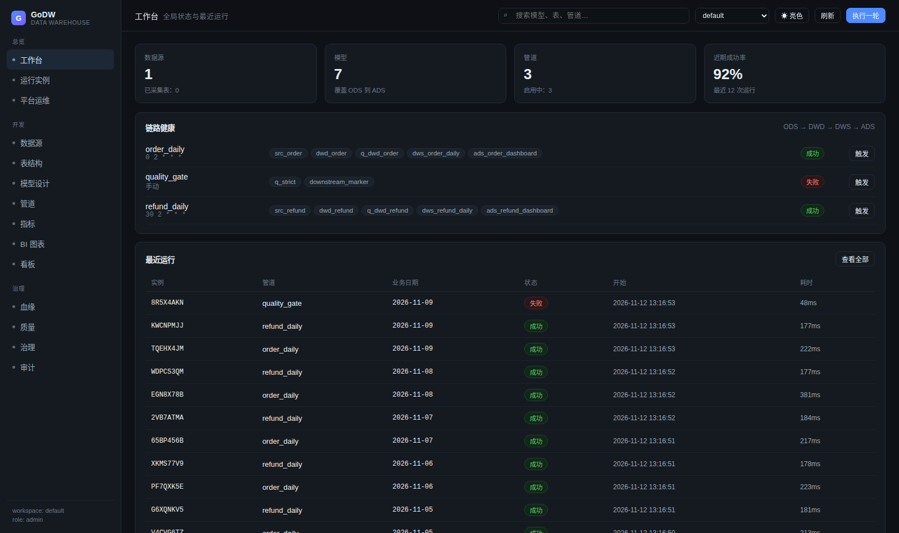 | 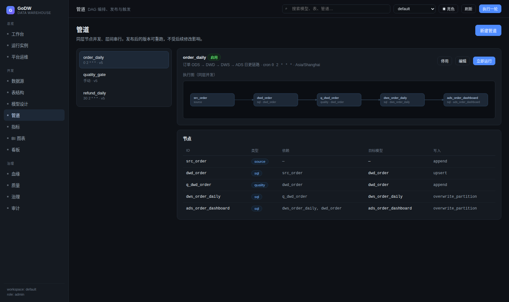 |

编排画布：左节点面板、中视口、右属性面板；选中实例后节点叠加运行状态（右下角为失败链路）。

| 编排画布 | 运行态叠加 |
|---|---|
| 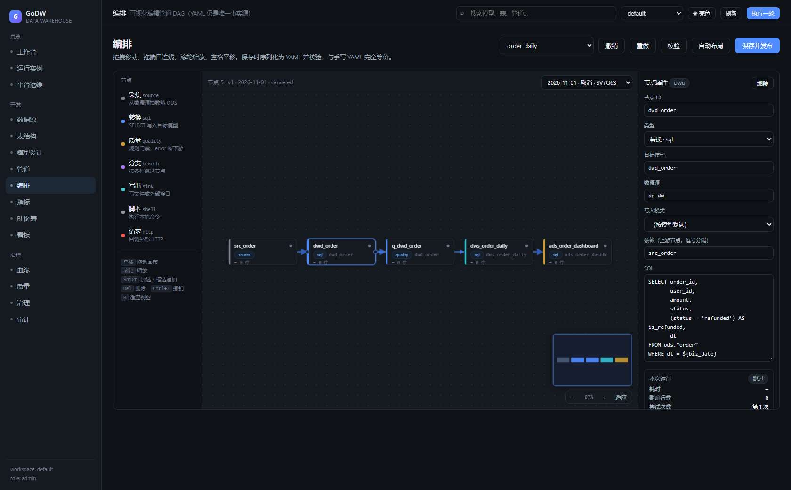 | 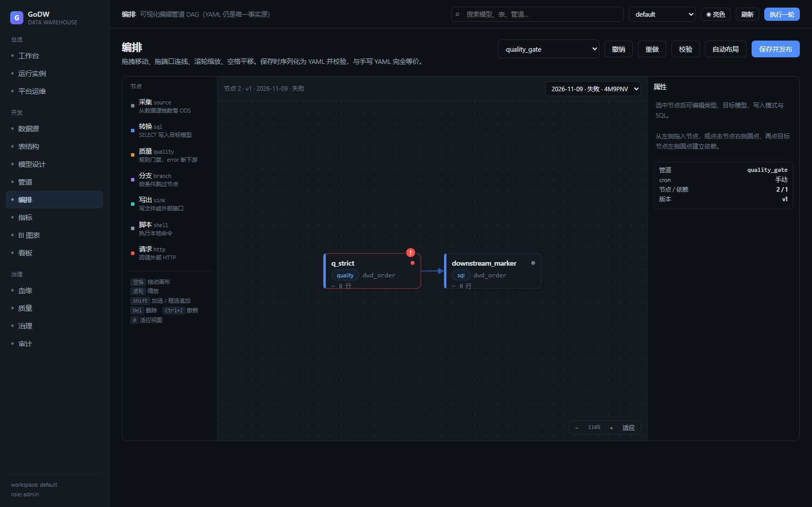 |

运行实例：筛选、分页、批量重跑；抽屉里按失败优先排序并支持只重跑某个节点。

| 运行实例 | 实例抽屉 |
|---|---|
| 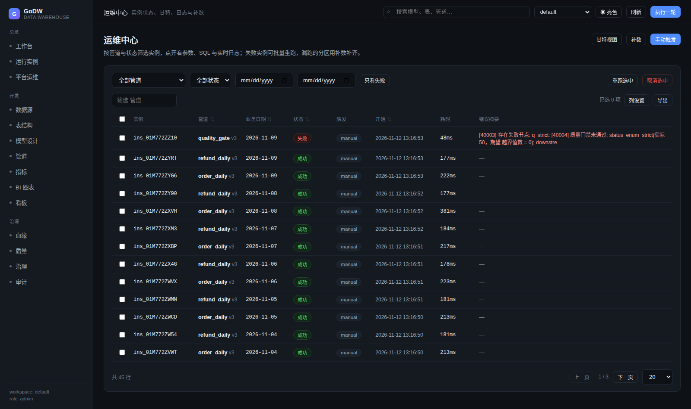 | 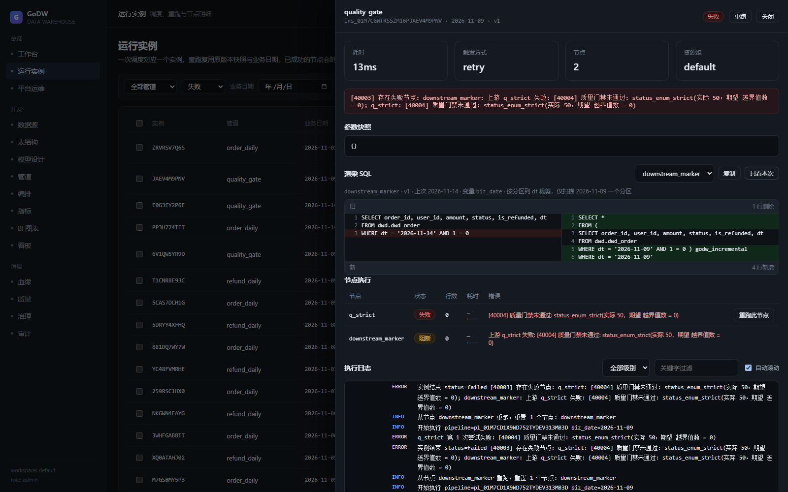 |

| 模型与 DDL | 指标趋势 |
|---|---|
| 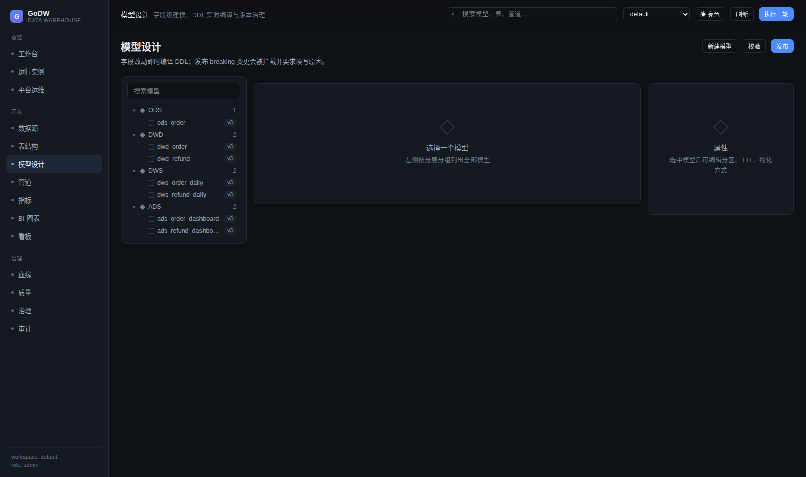 | 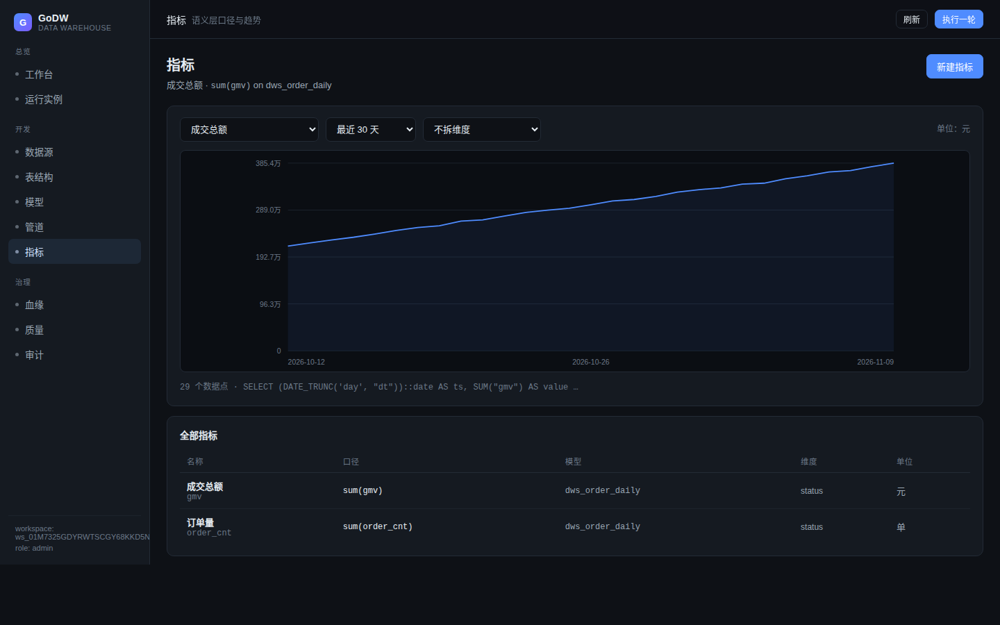 |

| 看板（全局时间/维度筛选 + hover tooltip） | 实例运维 |
|---|---|
| 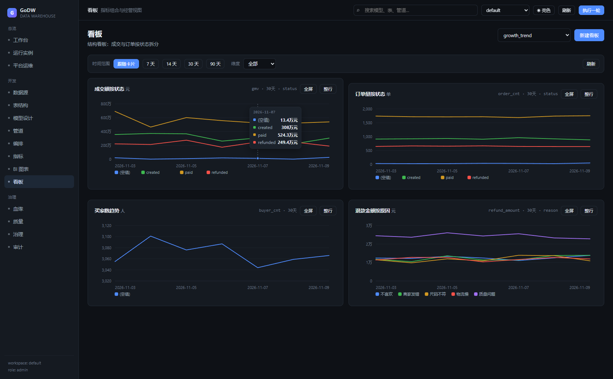 |  |

| 表结构（系统表默认收起 + 四档排序） | 质量门禁 |
|---|---|
| 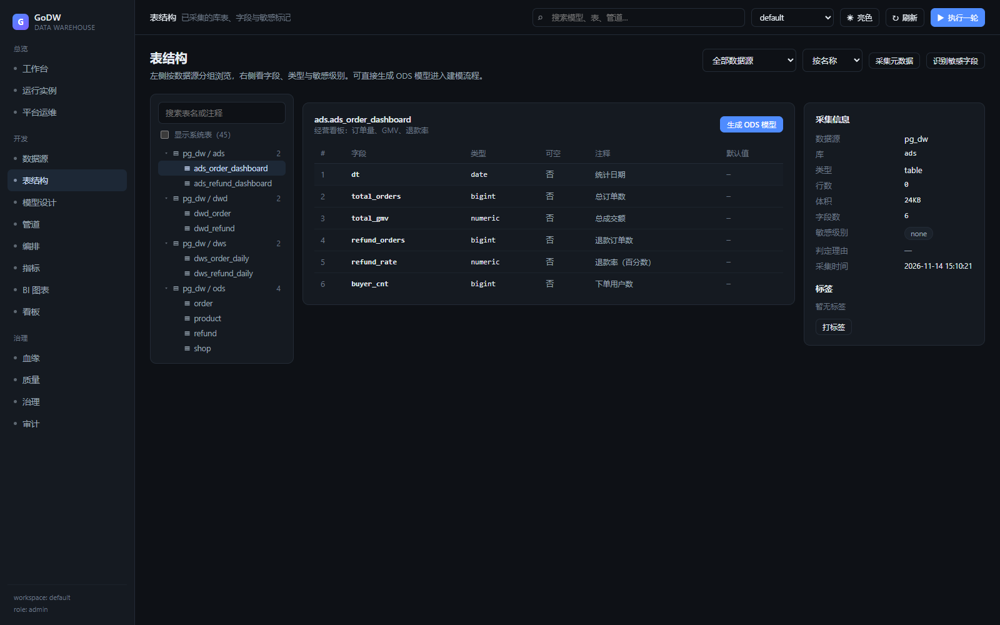 | 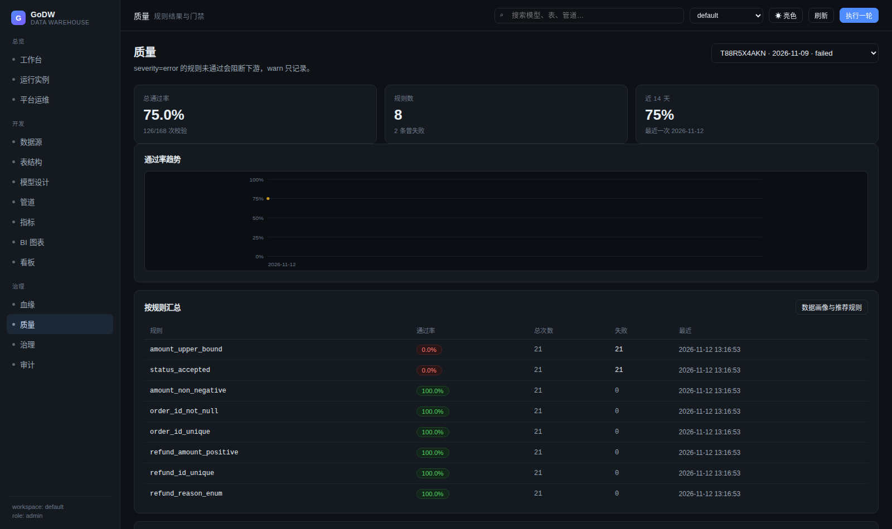 |

| 血缘：分层着色 + 图内搜索（Ctrl+F） | 双击聚焦 N 跳 |
|---|---|
| 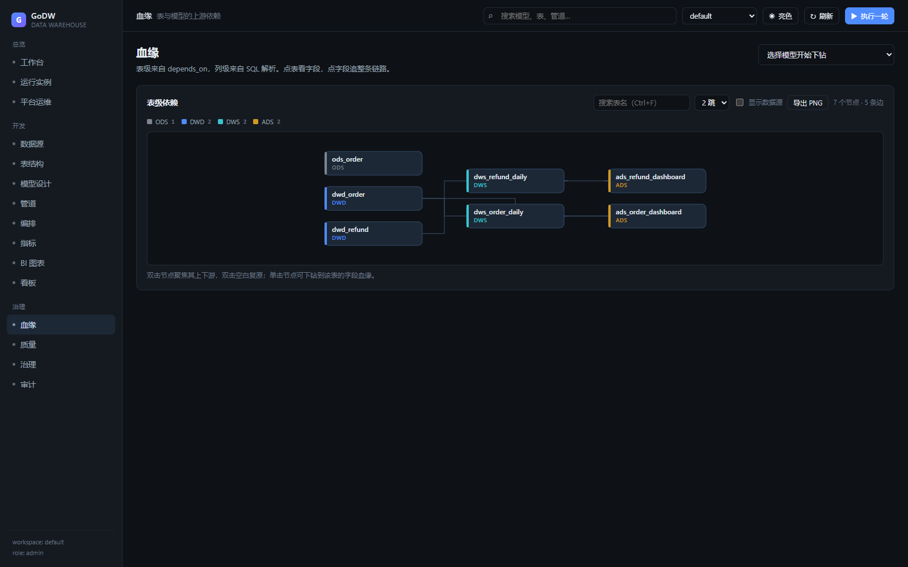 | 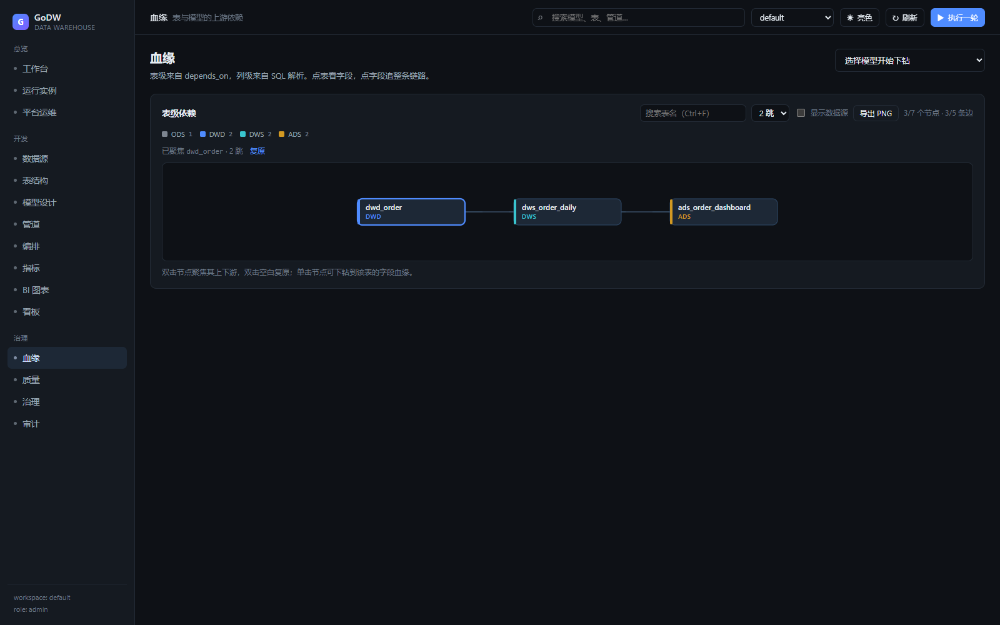 |

| 血缘（亮色主题，层色不再被深色写死） | 治理与审计 |
|---|---|
| 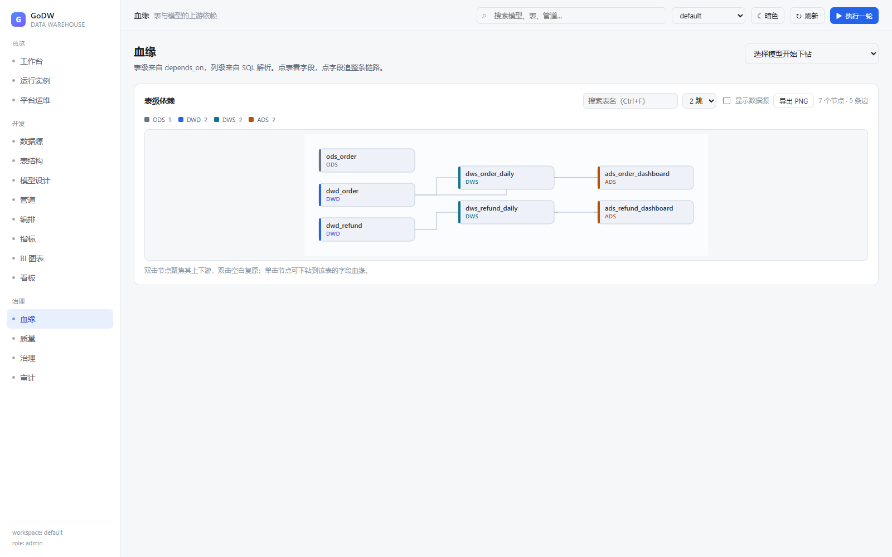 | 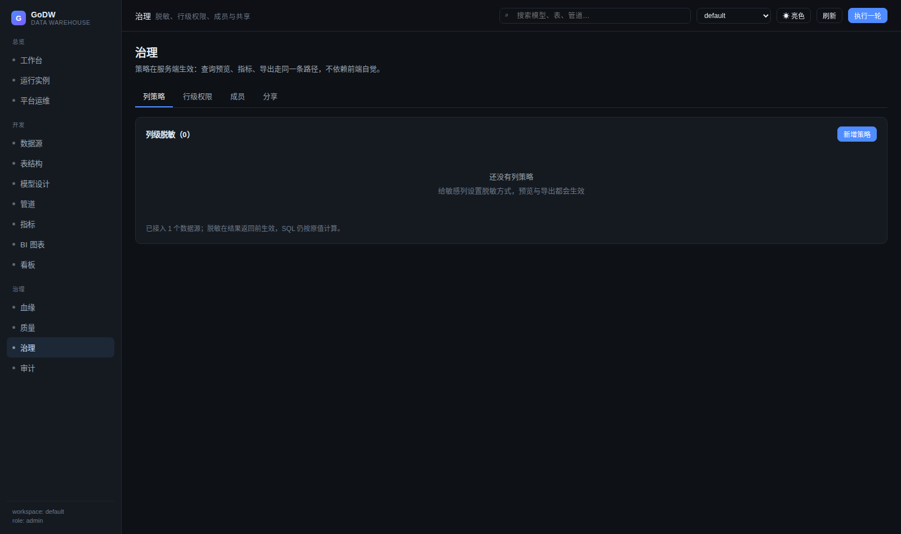 |

### 进度

100 张任务卡**全部完成**（`runner/PROGRESS.md` 可复算）。覆盖：四连接器与类型矩阵、七种写入策略、
增量推导、试跑与 dry-run、队列与资源组、传感器、日志流与告警、9 类质量规则与门禁、血缘图、
语义层与查询构建器、RBAC 与合规、前端全套页面、Compose/Helm 部署与样例数据集。

已知偏离（如实记录，不藏在代码里）：

- **前端技术选型**：卡片要求 React + Vite + AntD + Monaco + ECharts，实际为原生 JS + `go:embed`，
  以保住单二进制交付。差异与替代方案写在 [docs/tasks/E09-E10 头部](docs/tasks/E09-E10-前端与交付.md)。
- **引擎集成 CI 未在真实 Runner 上跑过**：PostgreSQL 16 / MySQL 8.4 / ClickHouse 24.10 /
  DuckDB 1.1 都在真实实例上跑通了建表、写入、质量、指标、采集与血缘（过程与发现的 8 个缺陷见
  [docs/11-引擎验证记录.md](docs/11-引擎验证记录.md)）。用例已固化为 `make test-integration`，
  CI 也配了对应 job，但只在本地等价环境验证过，还没在 GitHub Runner 上跑过一次。

## 0.2 设计文档与任务拆解

以下文档仍然有效，是实现的契约与后续迭代的路线图（100 张任务卡已转成机器可读清单）：

---

## 1. 为什么不是再造一个 Airflow

| 系统 | 值得借鉴 | 我们补齐的缺口 |
|---|---|---|
| Apache Airflow | DAG 调度、Operator 生态、回填 | Python 栈重、缺数仓分层语义、无内置建模与 BI |
| Dagster | 资产（Asset）思维、类型系统 | 学习曲线陡、Go 生态缺失 |
| dbt | 模型/测试/文档一体、SQL 优先 | 只管 T+D 转换，不管采集、调度与展示 |
| DolphinScheduler | 可视化编排、多租户 | 建模与语义层薄弱、插件开发成本高 |
| DataWorks / 阿里云 | 全链路分层与数据地图 | 闭源、绑定云厂商 |
| Metabase / Superset | 自助 BI、语义层 | 不做 ETL 与调度 |

**GoDW 的定位**：把「建模 DSL + DAG 编排 + 分层治理 + 语义层 BI」收进一个 Go 单体（可拆 worker），单二进制可跑，规模上能顶到万级日任务。

---

## 2. 六条通用性设计原则

1. **一切皆元数据**：数据源、模型、管道、质量规则、指标、看板全部是带版本的元数据对象；YAML 可导出、可 `git diff`、可 `apply`。
2. **引擎无关**：`Connector` + `Dialect` + `Capability` 三层抽象，同一份模型/管道可跑在 PostgreSQL、MySQL、ClickHouse、Doris、DuckDB 上，方言差异由能力矩阵降级处理。
3. **分层内建**：`ODS/DWD/DWS/ADS` 不是命名约定，而是强约束——层间引用规则、命名前缀、分区规范、生命周期由编译器校验。
4. **插件化**：连接器、算子、质量规则、告警渠道、认证方式均通过注册表扩展，新增一种数据源不改核心代码。
5. **可重跑即正确**：每次写入带 `run_id` / `bizdate` 审计列，写入策略保证幂等；重跑使用渲染快照，避免语义漂移。
6. **多环境多租户**：`workspace → env(dev/staging/prod)` 两级隔离，模型与管道一次定义、按环境绑定数据源。

---

## 3. 文档索引

| 文档 | 内容 | 读者 |
|---|---|---|
| [docs/01-总体架构.md](docs/01-总体架构.md) | 分层架构、组件职责、部署拓扑、技术选型与理由 | 全员 |
| [docs/02-元数据模型.md](docs/02-元数据模型.md) | 核心表 DDL、索引、状态机、幂等键 | 后端 |
| [docs/03-核心抽象与接口.md](docs/03-核心抽象与接口.md) | Go 包结构、核心 interface、DSL 语法、API 契约 | 后端 |
| [docs/tasks/E01-E02-基座与元数据.md](docs/tasks/E01-E02-基座与元数据.md) | 工程基座、数据源接入、元数据采集 | 后端 |
| [docs/tasks/E03-E04-模型与管道.md](docs/tasks/E03-E04-模型与管道.md) | 分层建模、DDL 编译、SQL 模板、写入策略 | 后端 |
| [docs/tasks/E05-E06-调度与质量血缘.md](docs/tasks/E05-E06-调度与质量血缘.md) | 调度执行、补数、质量门禁、列级血缘 | 后端 |
| [docs/tasks/E07-E08-BI与治理.md](docs/tasks/E07-E08-BI与治理.md) | 语义层、查询 API、看板、RBAC、审计 | 后端 |
| [docs/tasks/E09-E10-前端与交付.md](docs/tasks/E09-E10-前端与交付.md) | 可视化编排、运维中心、部署与压测 | 前端/运维 |
| [docs/10-部署手册.md](docs/10-部署手册.md) | Compose / Helm / 镜像构建 / 上线检查清单 | 运维 |
| [docs/11-引擎验证记录.md](docs/11-引擎验证记录.md) | 四种引擎的真实执行结果、发现的缺陷、未验证项 | 后端/运维 |
| [docs/12-离线包使用说明.md](docs/12-离线包使用说明.md) | 拿到压缩包后怎么装、怎么跑、常见故障 | 使用者/运维 |
| [docs/04-AI协作与验收规范.md](docs/04-AI协作与验收规范.md) | 任务卡怎么喂给 AI、编码红线、DoD、测试矩阵 | 全员 |
| [docs/05-无人值守执行方案.md](docs/05-无人值守执行方案.md) | 断点续跑、定时唤醒、失败升级的落地方案 | 运维/负责人 |
| `runner/` | 无人值守执行器：`tick.py` 状态机 + `tasks.json` + 进度板 | 运维 |

---

## 4. 里程碑

| 里程碑 | 范围 | 交付物（可演示） | 人日 |
|---|---|---|---|
| **M1** 地基 | E01 | `make up && make migrate && godw doctor` 全绿 | 11 |
| **M2** 数据进得来 | E02 | 接入 4 类数据源，元数据自动采集，表结构可视 | 19.5 |
| **M3** 模型立得住 | E03 | YAML 定义模型 → 一键生成 DDL → 发布/回滚 | 17 |
| **M4** 管道跑得通 | E04 | 可视化编排一条 ODS→DWD→DWS→ADS 管道并试跑 | 23 |
| **M5** 调度稳得住 | E05 | 定时调度、失败重试、补数、日志实时查看 | 26 |
| **M6** 数据信得过 | E06 | 质量规则 + 门禁 + 列级血缘 + 影响分析 | 18 |
| **M7** 业务看得懂 | E07 | 语义层指标、自助查询、拖拽看板、导出订阅 | 20.5 |
| **M8** 平台管得住 | E08 | 登录/RBAC/脱敏/审计/多租户 | 11.5 |
| **M9** 界面用得顺 | E09 | 全部前端页面，与后端联调完成 | 28 |
| **M10** 交付可运行 | E10 | 一键部署、样例数据集、压测报告、文档站 | 16.5 |

**合计 191 人日**（与 `runner/tasks.json` 逐卡汇总一致）。2 名后端 + 1 名前端 + AI 辅助，约 **12–14 周**。
关键路径：`E01 → E02 → E03 → E04 → E05 → E07`；`E09` 从 E04 起并行；`E06/E08` 可与 E05 并行。

---

## 5. 一条端到端样例（验收主线）

```
MySQL(业务库)  --采集-->  ods_order (ODS，按 dt 分区，原样保留 + 审计列)
                             │
                   清洗/去重/类型规范
                             ▼
                        dwd_order_detail (DWD，明细，主键 order_id+sku_id)
                             │
                  按日/按店铺聚合
                             ▼
                     dws_order_shop_1d (DWS，轻度汇总)
                             │
                    面向看板的宽表
                             ▼
                      ads_order_dashboard (ADS)
                             │
                  语义层 dataset: 订单主题
                             ▼
                  BI 看板：GMV / 客单价 / 退款率
```

这条链路会作为 **M4/M5/M7 的联合验收用例**，每日调度、可补数、可重跑、有质量校验、有血缘。

---

## 6. 现在怎么开始

```bash
# 查看包结构约定
cat docs/03-核心抽象与接口.md

# 领取第一张任务卡
cat docs/tasks/E01-E02-基座与元数据.md   # T0101
```

每张任务卡的格式固定为：

```
#### Txxxx · 任务名   `优先级` `预估`
**目标**：一句话说清为什么做
**要点**：实现路径、关键算法、易错点
**产出**：要新建/修改的文件
**验收**：可自动执行的判定条件
```

---

## 7. 无人值守执行

任务卡已转成机器可读清单（100 条，`runner/tasks.json`），依赖是手工校准的硬依赖，关键路径 41 人日、最大并行宽度 9。配套一个带锁、带重试、带断点续跑的状态机：

```bash
cd /workspace/数据仓库
python3 runner/tick.py status      # 总览
python3 runner/tick.py plan        # 依赖分层 + 哪些任务能并行
python3 runner/tick.py next        # 领取任务，生成 CURRENT.md
python3 runner/tick.py done --note "实现并通过测试"   # 或 fail / handoff
python3 runner/tick.py report      # 刷新 PROGRESS.md
```

单 worker 用 `PROMPT.txt`；要并行就建 3 个定时任务，分别用 `PROMPT-worker.txt` 并把 `{WORKER}` 换成 `w1`/`w2`/`w3`，每个 worker 在独立 git worktree 里干活，按文件范围自动错开。完整方案见 [docs/05-无人值守执行方案.md](docs/05-无人值守执行方案.md)。
